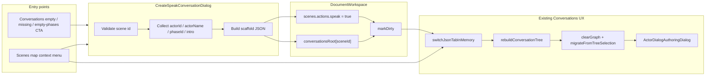

# Phase A: Create Speak Conversation for Empty Scenes

| Field | Value |
|-------|--------|
| **Author** | c0d3B0t555 (draft for Dan Feerst) |
| **Date** | 2026-10-25 |
| **Status** | Draft (rev 3 — load-before-mutate locked) |
| **Scope** | Timberline scene-editor (`v0.3.0.0_RC`) |
| **Motivating scene** | `stream_mine` (young man panning for gold) |
| **Related** | Conversations tab Phase 1 flowchart; Phase 2 graph persist is **out of scope** |

---

## Overview

Authors cannot start a Speak dialog for a scene that has no `conversations.json` entry. The Conversations tab left tree (`ConversationTree::rebuildConversationTree`) only lists scenes whose `speakPhases` arrays are non-empty, so create-from-scratch is blocked even when the scene already exists in `scenes.json` and may already have `actions.speak: true` (as `stream_mine` does today).

**Phase A** adds a small create affordance that scaffolds a minimal, runtime-valid `conversations.json[sceneId]` document (one scripted opener phase + starter choice with explicit reply fields), ensures `scenes.json` → `actions.speak = true` without clobbering other actions, persists through existing `DocumentWorkspace` save paths, then selects the new scene and auto-migrates into the existing Dialog flowchart / Actor Dialog authoring UX. Phase A does **not** dual-write flowchart topology back to JSON (that remains Phase 2).

A **required** prerequisite for any Scenes→Conversations handoff is an in-memory tab switch that does **not** call `loadActiveDocument()` (today tab clicks `requestReload()` and discard unsaved mutations while clearing dirty).

---

## Background & Motivation

### Current state (verified)

| Fact | Evidence |
|------|----------|
| Speak is keyed by **scene id** — no separate conversation document id | `docs/conversations.md`; `resources/conversations.json` top-level keys |
| Conversations today: `alpine_hardware`, `ridge_haberdashery`, `saloon_*`, `white_baptist_church_vestry` — **no `stream_mine`** | `resources/conversations.json` keys |
| `stream_mine` already has `actions.speak: true`, description/examine TTS, empty `speakDetails` | `resources/scenes.json` → `stream_mine` |
| Tree roots require non-empty `speakPhases` | `ConversationTree.cpp` ~354–365; empty message ~707 |
| Auto-migrate on tree select | `SceneEditorApp::wireModules` → `dialogFlow.migrateFromTreeSelection` |
| Persist conversations via dump of in-memory root | `DocumentWorkspace::saveConversationsDocument` |
| Dirty + Cmd/Ctrl+S → `saveAll()`; **no document undo stack** | `DocumentWorkspace::{dirty,markDirty,saveAll}`; `SceneEditorApp` save shortcuts |
| Tab click → `requestReload()` → `loadActiveDocument()` reloads from disk and sets `dirty = false` | `SceneMapCanvas::drawTabs` ~4624–4628; `SceneEditorApp.cpp` ~146, ~434–535 |
| Quit **autosaves** when dirty | `tools/scene-editor/main.cpp` ~104–105 |
| Runtime scripted phases require **non-empty `intro` and non-empty `choices`** | `SceneLoader.cpp` `parseConversationPhase` ~599–601 |
| Each choice requires non-empty `id`, non-empty `label`, and (`response` non-empty **or** `closePhase`); `closePhase` **defaults to `true`** when omitted | `SceneLoader.cpp` `parseConversationChoice` ~441, ~473–474 |
| Runtime Speak enablement also needs phases present | `ConversationManager::canSpeak` — `baseSpeakEnabled && !config.phases.empty()` |
| Migrate when `conversationsRoot` **lacks** the scene key: early return, **no** `clearGraph`, **no** status | `DialogFlowCanvas.cpp` ~3054–3057 |
| Migrate when key exists but `speakPhases` missing/empty: `clearGraph`, status `"No speakPhases for {id}"`, `migratedScope = sceneId\|empty` | `DialogFlowCanvas.cpp` ~3059–3065 |
| Empty choice `response` → migrate builds Player node but **skips** response Actor | `DialogFlowCanvas::migrateChoiceTree` ~2343 |

### Pain points

1. **Chicken-and-egg**: authors must hand-edit JSON to appear in the Conversations tree before they can use the flowchart / Edit Actor Dialog.
2. **Misleading Speak flag**: `stream_mine` already advertises Speak in the scene document, but in-game Speak stays inert because there are no phases (`canSpeak` fails).
3. **Easy to get schema wrong**: a naive empty `speakPhases: []` or a scripted phase with blank intro/choices will not parse / not speak; a choice with empty `response` and `closePhase: false` also fails parse.
4. **Tab reload discards dirty work**: any Create that then switches tabs via today’s reload path loses the scaffold and clears dirty.

### Motivating product story

Dan wants to author a Speak conversation with the young man at `stream_mine` entirely from the scene editor: create the conversation scaffold, then flesh out intro/choices with the existing Phase 1 tools.

---

## Goals & Non-Goals

### Goals

1. Provide an editor affordance **Create Speak conversation…** for a scene that lacks non-empty `speakPhases`.
2. Scaffold a **runtime-valid** minimal `conversations.json[sceneId]` entry (one scripted phase with intro + one starter choice that satisfies `parseConversationChoice`; explicit `actorId` / `actorName` for editor identity).
3. Set `scenes.json` → `actions.speak = true` for that scene while preserving other `actions.*` keys.
4. Persist via existing `DocumentWorkspace::saveConversationsDocument` / `scenes.save()` (or `saveAll()`), with dirty semantics matching real quit/tab behavior (see Dirty lifecycle).
5. After create: land on the Conversations tab via **safe in-memory tab switch**, rebuild the tree, force remigrate (`clearGraph` then `migrateFromTreeSelection`), and open Edit Actor Dialog on the opener.
6. Document reversibility expectations for authoring mistakes against the **real** quit/tab matrix.

### Non-Goals (Phase A)

- Phase 2 flowchart → JSON topology persist / layout dual-write.
- Creating conversations from palette stamps alone without a JSON scaffold.
- Multi-actor scaffolds, shops (`actorInventories`), Fight / Give-Take / Event nodes in the initial JSON.
- Migrating or rewriting legacy `speakDetails` into phases automatically.
- Full undo/redo stack for documents.
- AI-generated dialog prose as part of Create.
- Seed-intro-from-description checkbox / quote extraction (deferred; placeholder intro only).
- Delete Speak conversation UI (deferred follow-up).
- Changing quit-autosave product behavior (document it; optional later confirm-on-quit).
- Changing runtime Speak semantics / fixing SceneLoader top-level `actorId` under-consume quirk.
- Adding a scene-editor unit-test harness in Phase A (manual checklist against parse predicates instead).

---

## Key Decisions

| # | Decision | Rationale |
|---|----------|-----------|
| K1 | **Scaffold writes real `conversations.json` JSON first**, then migrates into the editor-local flowchart — do not invent a parallel “empty graph” document id. | Matches the existing data model (scene-id key) and reuses `migrateFromTreeSelection` / Actor Dialog `jsonPointer` dual-write. |
| K2 | **Phase type = `scripted`** with non-empty `intro` and **exactly one starter Player choice** with **explicit** `"response": "(Reply — edit me.)"` and `"closePhase": false`. | Satisfies `parseConversationPhase` and `parseConversationChoice`; empty/`omitted` response would default `closePhase: true` and end Speak immediately with no response Actor in migrate. Explicit reply keeps Start→Actor→Player→Actor handoff. |
| K3 | **Always set explicit `actorId` + `actorName`** on the opener; prefer **`phaseId == actorId`** for single-opener scaffolds. | Editor identity (tree grouping, migrate `phase.value("actorId")`, Edit Actor Dialog). Runtime `parseActorFields` currently ignores top-level `actorId` and falls back to `phase.id` when spoken actor is empty — alpine_hardware works with only `id: "merchant"`. Explicit fields remain the saloon-style convention; fixing SceneLoader under-consume is out of scope. |
| K4 | **Primary entry: Conversations tab** empty-state / missing-or-empty CTA bound to `selectedSceneId`. **Secondary:** Scenes map context menu (only after K12 ships). | Solves create-from-scratch on Conversations without a tab switch; map menu needs safe switch. |
| K5 | **Create dialog is a small modal** (scene id locked, actor id/name, phase id, intro, starter choice label) — not a silent one-click. | Authors need to name the NPC; silent create risks useless placeholders. |
| K6 | **Refuse create if non-empty `speakPhases` already exist**; offer **Open existing** instead. Empty object / empty array may be repaired in place. | Prevents accidental overwrite. |
| K7 | **Id sanitization** for actor/phase/choice ids: lowercase alnum + `_` (mirror `sanitizeSceneId` / `sanitizeLineId`). Display `actorName` stays free text; default name mirrors `formatActorDisplayName` (**duplicate locally or share a header** — not currently exported to the editor). | Consistent authoring hygiene without fake drop-in reuse. |
| K8 | **After create: Conversations tab → rebuild tree → select `scene:<id>` → `clearGraph()` then migrate → open Edit Actor Dialog on opener.** Auto-open defaults **on** (checkbox, default checked). | Fastest empty→editable opener path. |
| K9 | **Mark dirty; do not force-save on Confirm.** Cmd/Ctrl+S → `saveAll()`. Quit currently **autosaves** dirty docs; tab reload currently **discards** without prompt. | Matches existing save shortcut; authors must understand quit ≠ discard (see Dirty lifecycle). |
| K10 | **Intro default = short placeholder** `"(Opening line — edit me.)"`. Seed-from-description is **deferred** (not in Phase A UI). | Avoids copying long multi-voice scene descriptions / typoed quotes; authors paste deliberately. |
| K11 | **Delete Speak conversation UI deferred** past Phase A. Reversibility = git / hand-edit JSON / (unsaved) tab reload discard. | Keeps Phase A small. |
| K12 | **Required: safe in-memory tab switch** before any Create/Open path that leaves the Scenes tab. `SceneEditorApp::switchJsonTabInMemory(int index)` (name TBD) updates `activeTabIndex`, may **first-load** conversations from disk only while `!conversationsLoaded`, rebuilds the relevant UI, and **must not** call `loadActiveDocument()` / must not clear `dirty` / must not reload an already-loaded (possibly dirty) root. | Today `drawTabs` → `requestReload()` → `loadActiveDocument()` reloads disk and sets `dirty = false`, which would delete an unsaved scaffold and the `actions.speak` mutation. Blocking for **PR 4** map handoff. |
| K13 | **Actor id default = `npc`** (editable). No scene-id heuristics in Phase A. | Predictable; authors rename in the modal (`prospector` for stream_mine). |
| K14 | **Create CTA covers three states**, independent of migrate status chrome: (1) global empty tree, (2) conversations key **missing**, (3) key present with empty/missing `speakPhases`. App-owned banner/button; optionally teach migrate missing-key path to clear graph + shared empty status for consistency. | Missing-key early return today leaves old graph and no `"No speakPhases…"` status — cannot hang Create only on that string. |
| K15 | **Always load conversations from disk before first mutate; never invent a loaded empty root.** If `!conversationsLoaded`, call `loadConversationsDocument()` **before** `createSpeakConversationScaffold`. Never insert a scaffold into the default-empty `conversationsRoot` and flip `conversationsLoaded` without a disk load — `saveConversationsDocument` / quit-autosave dumps the whole root and would wipe every existing scene key. Never call `loadConversationsDocument()` again after the root may be dirty. | Prevents catastrophic overwrite of `resources/conversations.json` (alpine_hardware, saloon_*, …). |

---

## Proposed Design

### Architecture



### Sequence (happy path)

```mermaid
sequenceDiagram
  actor Author
  participant UI as CreateSpeakConversationDialog
  participant App as SceneEditorApp
  participant DW as DocumentWorkspace
  participant CT as ConversationTree
  participant DF as DialogFlowCanvas
  participant AD as ActorDialogAuthoringDialog

  Author->>UI: Create Speak conversation… (sceneId)
  UI->>DW: refuse if speakPhases non-empty
  Author->>UI: Confirm (actorId, intro, …)
  alt conversations not loaded this session
    UI->>DW: loadConversationsDocument() from disk (K15)
    Note over DW: Full root — never invent empty loaded root
  end
  UI->>DW: conversationsRoot[sceneId] = scaffold
  UI->>DW: scenes[sceneId].actions.speak = true
  UI->>DW: markDirty()
  UI->>App: switchJsonTabInMemory(conversations) if needed
  Note over App: No loadActiveDocument; no reload of dirty root
  UI->>CT: rebuildConversationTree + select scene:sceneId
  UI->>DF: clearGraph() then migrateFromTreeSelection
  Note over DF: Start → Actor intro → Player → Actor reply
  UI->>AD: openForActorDialog(opener node)
  Author->>DW: Cmd/Ctrl+S → saveAll()
  Note over DW: Quit while dirty also autosaves today
```

### Dirty lifecycle (authoritative)

| Action | Effect on unsaved Create scaffold |
|--------|-----------------------------------|
| **Confirm Create** | Mutates in-memory `conversationsRoot` + `scenes.actions.speak`; `markDirty()`; status `"Created Speak conversation for {id} (unsaved)"`. |
| **Cmd/Ctrl+S / File → Save** | `saveAll()` writes both docs; clears dirty. |
| **Quit (normal process exit)** | **Autosaves** if dirty (`main.cpp` ~104–105). Unsaved Create **is persisted** on quit — not discarded. |
| **Tab click today** | `requestReload()` → `loadActiveDocument()` reloads from disk, **discards** in-memory scaffold + speak mutation, sets `dirty = false` (UI shows Saved). **Broken for Phase A handoff** until K12. |
| **Tab switch after K12** | `switchJsonTabInMemory` keeps dirty buffers; no disk reload. |
| **Explicit Reload** (if any UI path calls `loadActiveDocument` while dirty) | Still discards without prompt today — call out in status/docs; optional confirm is post-Phase-A. |

Phase A **keeps quit-autosave** as-is (product change out of scope). Docs and Create status copy must not claim “restart discards.”

### Entry points (concrete)

#### 1. Conversations tab (primary)

When `document.isConversationsTab()`, App-owned CTA (do not rely solely on migrate status):

| State | Detection | UI |
|-------|-----------|-----|
| **(1) Global empty tree** | `conversation.roots.empty()` | Replace/augment “No scenes with speakPhases…” with **Selected scene:** `selectedSceneId` + **Create Speak conversation…** (disabled if selection empty / not in `scenes.json`). |
| **(2) Key missing** | `!conversationsRoot.contains(sceneId)` (the `stream_mine` case) | Banner/footer: “`{id}` has no Speak conversation” + **Create…**. Migrate today returns early with **no** status — CTA must not depend on `"No speakPhases for {id}"`. |
| **(3) Key present, empty phases** | object exists but `speakPhases` missing/empty array | Same Create CTA. Migrate already clears graph + sets `"No speakPhases for {id}"` — may add a Create button beside that status, still App-owned. |
| **Has non-empty phases** | `sceneHasSpeakPhases` | No Create; tree lists the scene. Optional **Open** is N/A on Conversations (already visible). |

Optional consistency fix (same PR as CTA or migrate polish): when key is missing, `migrateFromTreeSelection` should `clearGraph()`, set status `"No speakPhases for {id}"` (or `"No conversation entry for {id}"`), and set `migratedScope = sceneId + "|empty"` — matching state (3). Not a substitute for App CTA.

Implementation touchpoints:

- `ConversationTree.cpp` — empty-state draw/input (~703–712) and missing/empty banner.
- `SceneEditorApp.cpp` — modal ownership; CTA → create dialog; K12 helper.
- `DialogFlowCanvas.cpp` — optional missing-key status parity; Create button chrome only if App supplies callback (canvas must not own document writes).

#### 2. Scenes map context menu (secondary — after K12)

Extend map **parent** card context menu with **Create Speak conversation…** or **Open Speak conversation…** as **last** entries.

**Hard requirement:** replace magic `i == 0/1/2/3` branches with a single ordered `std::vector` / enum shared by `drawContextMenu` and `handleContextMenuClick` (today: 0 Edit, 1 Remove, 2 Connect to floor, 3 Place alternates). Appending Speak after those items is safe only if draw and click share one list.

**Target id:** always the **parent scene id**, never `parent#sub` map node ids. Sub-scene / alternate cards: either omit Speak items or resolve to parent before Create/Open.

#### 3. Deferred (not Phase A)

- Edit Scene dialog Create/Open Speak link.
- Seed-from-description.
- Delete Speak conversation.

### Create Speak conversation dialog

Small modal (Fight/Event chrome size).

| Field | Phase A behavior |
|-------|------------------|
| **Scene id** | Locked read-only. |
| **Actor id** | Required; sanitized; **default `npc`**. |
| **Actor name** | Required for UX; default by mirroring `formatActorDisplayName` locally (or shared header). |
| **Phase id** | Default **same as actor id**; sanitized. |
| **Intro text** | Multiline; default `"(Opening line — edit me.)"`; must be non-empty after trim. |
| **Starter choice label** | Default `"What brings you here?"`; always created. |
| **Open Edit Actor Dialog after create** | Checkbox, **default checked**. |

No seed-from-description checkbox in Phase A.

**Validation on Confirm:**

1. `scenes.hasScene(sceneId)`.
2. Conversations loaded (`conversationsLoaded`).
3. No existing non-empty `speakPhases` for `sceneId`.
4. `actorId` / `phaseId` / starter choice id non-empty after sanitize; ids start with a letter.
5. Intro trimmed non-empty.
6. Starter choice: non-empty label; scaffold forces non-empty placeholder `response` and `closePhase: false` (helper always writes that shape — not left to defaults).

### Scaffold JSON shape

Canonical minimal document (runtime-valid under `parseConversationPhase` **and** `parseConversationChoice`):

```json
{
  "stream_mine": {
    "speakPhases": [
      {
        "id": "npc",
        "type": "scripted",
        "actorId": "npc",
        "actorName": "Npc",
        "resetOnSceneEnter": true,
        "intro": "(Opening line — edit me.)",
        "choices": [
          {
            "id": "player_opener",
            "label": "What brings you here?",
            "response": "(Reply — edit me.)",
            "closePhase": false
          }
        ]
      }
    ]
  }
}
```

**Full validity predicates the helper must enforce:**

| Layer | Rule |
|-------|------|
| Phase | `id` non-empty; `type == scripted`; `intro` non-empty; `choices` non-empty array |
| Choice | `id` non-empty; `label` non-empty; `response` non-empty **or** `closePhase == true` |
| Phase A choice shape | Always write non-empty placeholder `response` **and** `"closePhase": false` so migrate emits a response Actor and Speak does not terminate on the first click |

Notes:

- Omit TTS bags until Generate TTS from Actor/Player dialogs.
- Omit `resumeIntro` until authored.
- Do **not** create `actorInventories` / `attackEncounters`.
- Insert new top-level key, or **fill** `speakPhases` when an empty object / empty array already exists.

Reference vocabulary: `alpine_hardware.speakPhases[0]` (scripted + choices + intro); `saloon_interior` bartender (explicit `actorId` / `actorName`).

### `scenes.json` mutation

```cpp
nlohmann::json* scene = docs.scenes.sceneJson(sceneId);
if (scene == nullptr) /* fail */;
if (!scene->contains("actions") || !(*scene)["actions"].is_object())
    (*scene)["actions"] = nlohmann::json::object();
(*scene)["actions"]["speak"] = true;  // preserve examine/hit/use/take
```

Do **not** clear `speakDetails`; runtime prefers phases when present.

### Persist / dirty

```text
conversationsRoot[sceneId] = { speakPhases: [...] }   // or fill speakPhases in place
scenes.actions.speak = true
docs.markDirty()
// NEVER saveConversationsDocument / scenes.save / saveAll on Confirm
```

On explicit Save: `DocumentWorkspace::saveAll()`. On quit: existing autosave if dirty.

### Tree + migrate handoff

**Load / mutate ordering (K15) — single allowed rule:**

```text
if (!docs.conversationsLoaded) {
    // ONLY path that may touch disk for conversations in the Create flow:
    if (!docs.loadConversationsDocument()) → fail (ConversationsNotLoaded / load error)
}
// NEVER: invent conversationsRoot = { sceneId: scaffold } and set conversationsLoaded=true
// NEVER: loadConversationsDocument() again after scaffold mutate (would clobber dirty root)
createSpeakConversationScaffold(...)   // requires conversationsLoaded == true
markDirty()
switchJsonTabInMemory(conversations)   // if needed; first-load only when still unloaded
clearGraph() + migrateFromTreeSelection(...)
```

Map Create and Conversations Create share this order. `createSpeakConversationScaffold` returns `ConversationsNotLoaded` if called while unloaded — callers must load first, not mutate an empty default root.

After successful in-memory create:

1. Ensure conversations were loaded from disk **before** scaffold (K15). Conversations-tab CTA normally already has them loaded; map Create must `loadConversationsDocument()` first when `!conversationsLoaded`.
2. Run scaffold mutate + `actions.speak` + `markDirty()`.
3. If not already on Conversations: **`switchJsonTabInMemory(conversationsIndex)`** (K12). Never `requestReload` / `loadActiveDocument` here. The switch helper may first-load only if somehow still unloaded; it must **not** reload after a dirty mutate.
4. `conversation.rebuildConversationTree()`.
5. `selectedSceneId = sceneId`; `conversation.selectedKey = "scene:" + sceneId`; expand that root.
6. **`dialogFlow.clearGraph()`** (also clears `migratedScope` — see `DialogFlowCanvas.cpp` ~116) **then** `migrateFromTreeSelection("scene:" + sceneId, sceneId)`.
7. Open Edit Actor Dialog on opener (`jsonPointer` ending in `/intro`) when checkbox set.

**Why `clearGraph` before migrate:** If the scene key was previously **missing**, migrate’s early return left any prior graph intact and never updated status. After create, the key exists — but if `migratedScope` already equals the new scoped rev from a partial attempt, dedupe could skip. Calling `clearGraph()` first is the reliable remigrate. (A prior `sceneId|empty` marker alone would not collide with `scene:id|mgr…`, but missing-key stale graphs still need the clear.)

### Actor / phase id conventions

| Rule | Value |
|------|--------|
| Default actor id | `npc` |
| Default phase id | same as actor id |
| Default actor name | title-case mirror of `formatActorDisplayName` |
| Style | lowercase snake_case ids |

No scene-id heuristics in Phase A.

### Reversibility (authoring mistakes)

| Situation | Recovery |
|-----------|----------|
| Created, **not** Cmd+S, then **tab reload / `loadActiveDocument`** (pre-K12 or explicit reload) | Discarded without prompt; dirty cleared. |
| Created, **not** Cmd+S, then **quit** | **Autosaved** to disk (quit path). |
| Created and **Cmd+S** / quit-autosaved | Remove `conversations.json` key via git / hand-edit; optionally set `actions.speak` false if no legacy `speakDetails`. Delete UI deferred (K11). |
| Wrong actor id after save | Prefer Edit Actor Dialog / phase id rename over delete/recreate. |

Status after Confirm: `"Created Speak conversation for {sceneId} (unsaved)"`. Docs note quit autosave.

---

## API / Interface Changes

### New types / helpers (proposed)

```cpp
// tools/scene-editor/SpeakConversationCreate.h
struct SpeakConversationCreatePayload {
    std::string sceneId;       // locked
    std::string actorId;       // sanitized; default "npc"
    std::string actorName;     // display
    std::string phaseId;       // sanitized; default == actorId
    std::string intro;         // required non-empty
    std::string starterChoiceId;    // default "player_opener"
    std::string starterChoiceLabel; // default "What brings you here?"
    bool openActorDialogAfter = true;
    // no seedIntroFromDescription in Phase A
};

enum class SpeakConversationCreateStatus {
    Ok,
    SceneMissing,
    ConversationsNotLoaded,
    AlreadyHasPhases,
    InvalidIds,
    EmptyIntro,
    InvalidChoice,   // label/response/closePhase predicate failed
    MutateFailed     // in-memory docs mutation failed (not a disk I/O error)
};

SpeakConversationCreateStatus createSpeakConversationScaffold(
    DocumentWorkspace& docs,
    const SpeakConversationCreatePayload& payload,
    std::string& errorOut);

bool sceneHasSpeakPhases(const DocumentWorkspace& docs, const std::string& sceneId);

// SceneEditorApp — required for Scenes→Conversations handoff (K12)
bool switchJsonTabInMemory(int tabIndex);
// Updates activeTabIndex; rebuilds UI for the target tab.
// If switching to Conversations and !conversationsLoaded: may call
// loadConversationsDocument() ONCE (first load from disk only).
// Must NOT: call loadActiveDocument(); clear dirty; reload when
// conversationsLoaded (dirty scaffold must survive).
// Must NOT: fabricate an empty conversationsRoot and mark it loaded.

// Callers of Create (map or Conversations) MUST:
//   1) if (!conversationsLoaded) loadConversationsDocument();  // K15
//   2) createSpeakConversationScaffold(...);  // fails if still unloaded
//   3) switchJsonTabInMemory(conversations) if needed;
```

`createSpeakConversationScaffold` owns JSON mutation + `actions.speak` and **requires** `conversationsLoaded`; UI owns load-before-mutate, tab switch, migrate, and open dialog.

### Existing interfaces reused

| API | Role |
|-----|------|
| `DocumentWorkspace::markDirty` / `saveConversationsDocument` / `saveAll` | Persist |
| `ConversationTree::rebuildConversationTree` | Show new root |
| `DialogFlowCanvas::clearGraph` / `migrateFromTreeSelection` | Remigrate |
| `ActorDialogAuthoringDialog::openForActorDialog` | Opener edit |
| Local sanitize helpers mirroring `sanitizeSceneId` / `sanitizeLineId` | Id hygiene |

### UI wiring

- `SceneEditorApp` holds create modal; implements K12; wires CTA callbacks.
- `ConversationTree` optional `onCreateSpeakRequest` **or** App hit-tests empty-state using `conversation.listBounds`.
- Map parent menu: shared action enum/vector including Create/Open Speak as last items.

---

## Data Model Changes

### Schema

**No new schema fields.** Phase A inserts a conventional subset of the existing Speak phase / choice model.

### Migration

- N/A for existing content.
- Scenes with `actions.speak: true` but no conversations entry become coherent once scaffolded.
- Legacy `speakDetails`-only scenes untouched unless author Creates (phases then win at runtime).

### Storage impact

Negligible: ~0.5–2 KB JSON per new conversation before TTS assets.

---

## Alternatives Considered

### Alternative 1 — Hand-edit JSON / external merge scripts only

**Pros:** Zero editor work; already how alpine/haberdashery tools work.  
**Cons:** Blocks product goal; easy to violate parse predicates; Conversations UX unreachable.  
**Rejected** for Phase A primary path.

### Alternative 2 — Editor-local empty flowchart without writing `conversations.json` until Phase 2

**Pros:** Aligns with “layout not persisted” Phase 1 story.  
**Cons:** Dual-write needs real `jsonPointer` targets; Speak still broken in-game.  
**Rejected.**

### Alternative 3 — Scaffold a `once` phase with `text` only (no choices)

**Pros:** Smaller JSON; satisfies `once` parse.  
**Cons:** No Player Dialog surface; worse handoff.  
**Rejected** for Phase A (locked: one scripted choice with explicit reply).

### Alternative 4 — One-click create with fixed `npc` / blank intro, no modal

**Pros:** Fastest click path.  
**Cons:** Blank intro fails parse; no naming step.  
**Rejected** as sole UX; modal with defaults (K5/K13).

### Alternative 5 — Terminal stub choice (`response: ""`, `closePhase: true`)

**Pros:** Minimal; parses via default closePhase.  
**Cons:** First click ends Speak; migrate skips response Actor.  
**Rejected** in favor of placeholder reply + `closePhase: false` (K2).

### Alternative 6 — Gate Create to Conversations tab only forever (never fix tab switch)

**Pros:** Avoids K12 work.  
**Cons:** Map discovery stays broken; handoff sequence from Scenes impossible.  
**Rejected** as end state; K12 is required before **PR 4** map menu (Conversations-only Create may ship in PR 3 after helper + K12; map menu still waits on K12).

### Alternative 7 — Mutate empty default `conversationsRoot` then skip disk load (“mutate-then-skip-reload”)

**Pros:** Avoids an extra load call on map Create.  
**Cons:** `saveConversationsDocument` / quit-autosave dumps the entire in-memory root — a fabricated `{sceneId: scaffold}` root would **wipe** alpine_hardware, saloon_*, etc. Also contradicts `ConversationsNotLoaded` validation.  
**Rejected** (K15).

---

## Security & Privacy Considerations

| Topic | Assessment |
|-------|------------|
| Threat model | Local content authoring tool; no network I/O in Create path. |
| Path traversal | Scene/actor ids sanitized to `[a-z0-9_]`; JSON object keys only in Phase A. |
| Secrets | Untouched. |
| Data handling | Writes only under `resources/conversations.json` and `resources/scenes.json`. |

Severity of misuse is low (content corruption), mitigated by refuse-if-exists + dirty/save discipline.

---

## Observability

| Signal | Mechanism |
|--------|-----------|
| Success / failure | Modal / canvas `status` string. |
| Logging | Optional `TraceLog(LOG_INFO, "Created speak conversation for %s", …)` on Confirm. |
| Metrics / alerting | N/A. |
| Verification | Manual checklist: create on `stream_mine` → Confirm (unsaved) → switch tabs via K12 without losing dirty → Cmd+S → relaunch → tree shows scene → New Game Speak shows intro + choice + reply stub. Also verify quit-while-dirty autosaves. |

---

## Risks

| Risk | Severity | Mitigation |
|------|----------|------------|
| Scaffold fails `parseConversationChoice` (empty response + `closePhase: false`) | **High** | Helper always writes placeholder response + `closePhase: false`; checklist cites both parse predicates. |
| Tab switch via `loadActiveDocument` drops scaffold + clears dirty | **High** | **K12 required** before Scenes→Conversations handoff / **PR 4**; PR 3 Conversations path still benefits from K12 on incidental tab clicks. |
| Fabricated empty `conversationsRoot` + Save/quit wipes all conversations | **High** | **K15**: always `loadConversationsDocument()` before first mutate; never invent a loaded empty root. Checklist: map Create with conversations never loaded still preserves `alpine_hardware` after Save. |
| Overwriting an existing conversation | **High** | Refuse when `speakPhases` non-empty. |
| Missing-key migrate leaves stale graph / no CTA hook | **Medium** | App-owned three-state CTA (K14); `clearGraph` before remigrate; optional migrate missing-key parity. |
| Authors think quit discards unsaved Create | **Medium** | Document quit-autosave; status/docs wording. |
| Authors think flowchart layout is saved | **Low** | Status: JSON scaffold on Save; graph layout editor-local until Phase 2. |
| Map menu magic indices break floor connect | **Medium** | Shared enum/vector for draw+click (**PR 4**). |
| Top-level `actorId` ignored by SceneLoader | **Low** | Prefer `phaseId == actorId`; document quirk; out of scope to fix. |

---

## Rollout Plan

1. Land K12 in-memory tab switch + scaffold helper on `v0.3.0.0_RC` (no feature flag).
2. Ship Conversations CTA + modal; dogfood Create without leaving Conversations.
3. Ship map menu only after K12 is merged.
4. Docs/tutorial with dirty matrix (quit autosave vs tab discard vs Save).
5. Optional content PR for real `stream_mine` prose (separate from tooling).
6. Rollback: revert tooling PRs; delete accidental conversation keys from content commits.

### Reversibility expectations (author-facing)

- Confirm → memory + dirty until Save **or quit-autosave**.
- Save / quit-autosave → git-revert JSON keys to undo.
- Phase A creates no TTS files to purge.

---

## Open Questions

Resolved for Phase A (see Key Decisions): actor default `npc` (K13); auto-open Edit Actor Dialog on (K8); seed deferred (K10); scripted choice with explicit reply/`closePhase: false` (K2); Delete deferred (K11); K12 tab switch required; **K15 load-from-disk before first mutate** (no mutate-then-skip-reload).

**Post-Phase-A / optional product input (non-blocking):**

1. Replace quit-autosave with confirm-on-quit / discard option?
2. Add Create/Open Speak inside Edit Scene dialog?
3. Seed-from-description algorithm (source field, quote extraction, fallback) if revisited?
4. Scene-id → default actor heuristics (`mine` → `prospector`)?
5. Teach migrate missing-key path empty status in the same PR as CTA or a tiny follow-up?

---

## References

- `docs/conversations.md` — Speak enablement; Conversations tab Phase 1; migrate behavior.
- `docs/scene-editor-tutorial.md` — update on ship.
- `resources/conversations.json` — phase/choice examples.
- `resources/scenes.json` → `stream_mine`.
- `tools/scene-editor/ConversationTree.cpp` — root filter; empty message.
- `tools/scene-editor/DialogFlowCanvas.cpp` — `clearGraph` (~116); missing-key early return (~3054–3057); empty phases status (~3059–3065); `migrateChoiceTree` empty response skip (~2343).
- `tools/scene-editor/DocumentWorkspace.cpp` — save / dirty.
- `tools/scene-editor/SceneMapCanvas.cpp` — `drawTabs` reload; map context menu indices.
- `tools/scene-editor/SceneEditorApp.cpp` — `requestReload` → `loadActiveDocument`; save shortcuts.
- `tools/scene-editor/main.cpp` — quit autosave when dirty.
- `tools/scene-editor/ActorDialogAuthoringDialog.cpp` — `openForActorDialog`; dual-write.
- `src/SceneLoader.cpp` — `parseConversationPhase` ~599–601; `parseConversationChoice` ~441, ~473–474; `parseActorFields` ~180–200.
- `src/ConversationManager.cpp` — `canSpeak`; spoken actor fallback to phase id.

---

## PR Plan

Ordered so **safe tab switch lands before any Scenes→Conversations Create/Open handoff**. No fake unit-test harness claim; use a manual checklist citing parse predicates.

### PR 1 — Scaffold helper + manual parse checklist

- **Title:** `editor: add Speak conversation scaffold helper (Phase A)`
- **Files/components:** `tools/scene-editor/SpeakConversationCreate.{h,cpp}`; CMake scene-editor target.
- **Dependencies:** none
- **Description:** `sceneHasSpeakPhases`, payload validation, JSON scaffold with explicit `response` + `closePhase: false`, `actions.speak = true`, `markDirty`. Status enum without disk `PersistError` (`MutateFailed` for in-memory failure only). PR body checklist: validate sample output against `parseConversationPhase` + `parseConversationChoice` rules (cite line refs). **No** new gtest harness.

### PR 2 — In-memory JSON tab switch (K12)

- **Title:** `editor: switch JSON tabs without reloading dirty documents`
- **Files/components:** `SceneEditorApp.{h,cpp}`; `SceneMapCanvas` tab click path (`requestReload` vs in-memory switch); any callers that assumed reload-on-tab.
- **Dependencies:** none (can merge before or with PR 1; **must merge before PR 4**)
- **Description:** Implement `switchJsonTabInMemory`; tab clicks that only change `scenes.json` / `conversations.json` / `items.json` views must not call `loadActiveDocument()` when documents are already loaded and dirty buffers must be preserved. When conversations were **never** loaded, first-load via `loadConversationsDocument()` only (K15) — never fabricate an empty loaded root. Keep an explicit Reload action if one exists. Checklist: dirty scene edits survive tab switch; switching to Conversations with unloaded conversations loads full disk JSON (alpine_hardware still present) without clearing scenes dirty.

### PR 3 — Create modal + Conversations three-state CTA + remigrate handoff

- **Title:** `editor: Create Speak conversation dialog (Conversations tab)`
- **Files/components:** `SpeakConversationCreateDialog.{h,cpp}`; `SceneEditorApp` wiring; `ConversationTree` empty/missing/empty-phases CTA; optional migrate missing-key status parity in `DialogFlowCanvas`.
- **Dependencies:** PR 1; PR 2 (dirty survives incidental tab clicks after Create; K12/K15 load rules)
- **Description:** Modal with locked defaults (K5/K8/K10/K13); Confirm path enforces **load-from-disk before mutate** (K15) then scaffold → rebuild → `clearGraph` + migrate → open Edit Actor Dialog; status unsaved. App-owned CTA for states (1)(2)(3) per K14. Does not force Save. Refuse scaffold when `!conversationsLoaded` rather than inventing a root.

### PR 4 — Scenes map context menu Create/Open Speak

- **Title:** `editor: map context menu Create/Open Speak conversation`
- **Files/components:** `SceneMapCanvas.cpp/.h` — shared menu action enum/vector for draw+click; Speak items last; parent scene id only.
- **Dependencies:** **PR 2 (K12) and PR 3** (create/open entry API)
- **Description:** Secondary discovery from Scenes map. Existing phases → Open (in-memory switch + select + migrate). Else → Create dialog (K15: if conversations never loaded this session, `loadConversationsDocument()` **before** scaffold). Do not use magic indices for floor connect. **Checklist:** Create from map with conversations never loaded this session → Save → `alpine_hardware` (and other keys) still present in `conversations.json`.

### PR 5 — Docs + tutorial

- **Title:** `docs: Create Speak conversation for empty scenes`
- **Files/components:** `docs/conversations.md`, `docs/scene-editor-tutorial.md`, optionally `docs/README.md`.
- **Dependencies:** PR 3 (behavior); mention PR 2 dirty/tab matrix
- **Description:** Entry points, scaffold shape (including choice predicate), Save vs quit-autosave vs tab discard, flowchart layout still Phase 2, reversibility without Delete UI.

### PR 6 (optional content) — Author `stream_mine` Speak

- **Title:** `content: stream_mine prospector Speak scaffold`
- **Files/components:** `resources/conversations.json` (`stream_mine`); verify `actions.speak` already true.
- **Dependencies:** PR 3 (create in-editor) or hand-apply same JSON shape
- **Description:** Real opener prose; rename actor to `prospector` in content as desired. Separate review from tooling.

### PR 7 (optional follow-up) — Delete Speak conversation (+ optional reload confirm)

- **Title:** `editor: delete Speak conversation (optional)`
- **Files/components:** Conversations confirm UX; optionally prompt before `loadActiveDocument` when dirty
- **Dependencies:** PR 3
- **Description:** Reversibility UX. **Not** the place for K12 (already PR 2). Quit-autosave product change remains a separate product decision (Open Question post-Phase-A #1).
